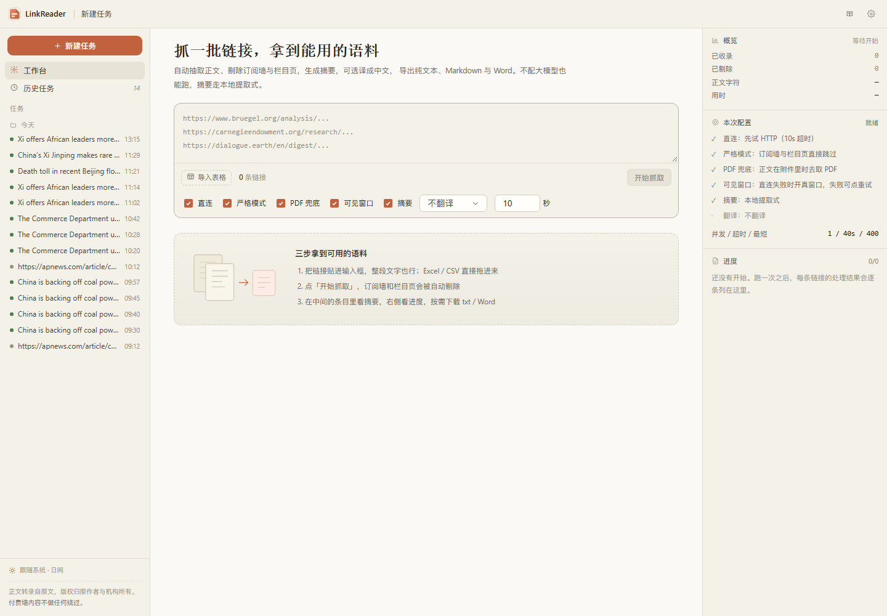
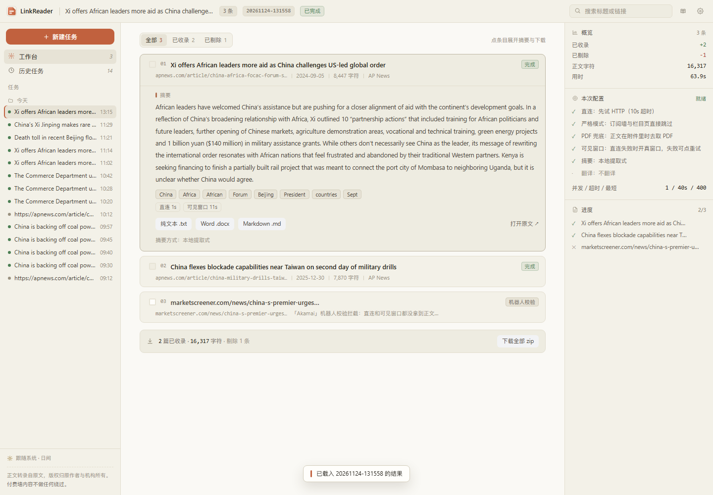
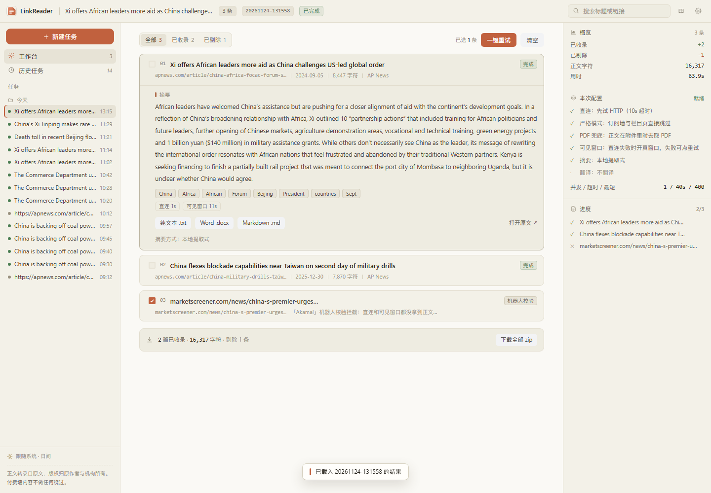
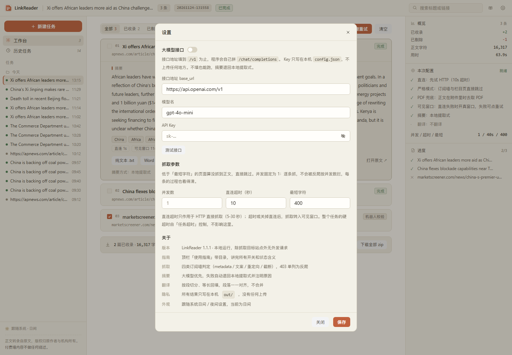
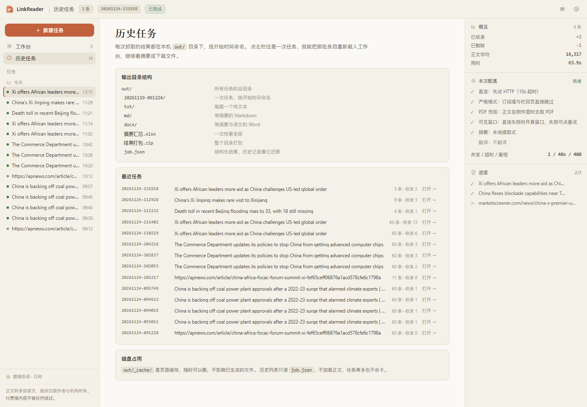
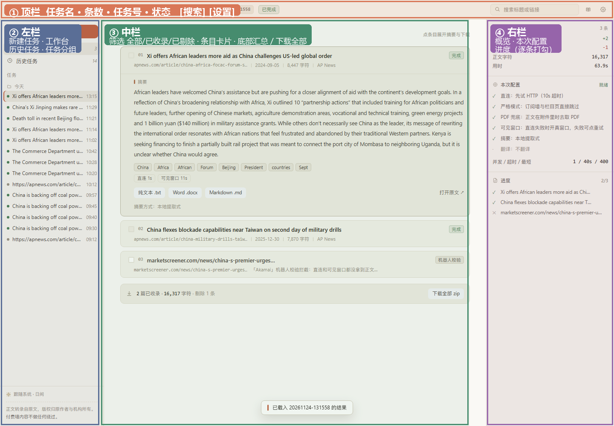

# 链接抓取摘要器 · LinkReader

[](https://github.com/Jasonwei21/LinkReader/releases/latest)


给一批文章链接，自动抓正文、生成摘要、翻译成中文，导出纯文本 / Markdown / Word，再给一张汇总表。
本地网页界面。不配大模型也能用（摘要在本机算），配了就用 OpenAI 接口做摘要和翻译。

**不想装 Python？** 到 [Releases](https://github.com/Jasonwei21/LinkReader/releases/latest) 下载 `LinkReader.exe`，双击即用。



> 截图为 1.1.1 实际界面，随版本会有细微调整。

---

## 一、启动

**最省事：双击 `LinkReader.exe`。** 没有黑色命令行窗口，浏览器自己弹出来；
关掉浏览器标签页，10 秒内后台服务自己停掉、进程退出，任务管理器里不留东西。
结果和配置写在 exe 旁边（`out/`、`config.json`），把 exe 单独拷走换台机器照样能用。

下面是**从源码跑**的方式，改代码、调试用。

**Windows**：双击 `启动.bat`。首次运行会自动补齐依赖，然后打开浏览器。

`.bat` 里只有英文提示，这是故意的：cmd.exe 按系统本地代码页（简体中文是 GBK）解析批处理
文件，里面写中文会把后面的命令字节吃掉，报出 `'e' is not recognized`、
`'penpyxl' is not recognized`、`'uirements.txt' is not recognized` 这种莫名其妙的错。
所以中文提示全部放在 `launch.py` 里，由 Python 输出。

**找不到 Python 的报错说明**：如果双击后看到

```
Python was not found; run without arguments to install from the Microsoft Store...
```

说明这台机器**没装真的 Python**。PATH 里的 `python.exe` 指向
`%LOCALAPPDATA%\Microsoft\WindowsApps\`，那是微软商店的**占位符**——它存在、能被
`where` 找到，但运行任何脚本都只会打印这句话。

启动器不会只信 `where`，而是逐个候选**实跑一次** `-c "import sys"`，退出码不为 0 就跳过。
查找顺序：

1. 环境变量 `LINKREADER_PY`（想指定解释器就设这个）
2. `py -3` / `python` / `python3`
3. `%LOCALAPPDATA%\Programs\Python\Python3*`、`%ProgramFiles%\Python3*`、`C:\Python3*`
4. 兜底：WorkBuddy 自带的 Python（会打印提示，建议自己装一个）

全都没有就明确告诉你装法（`winget install Python.Python.3.12`），不会一闪而过。

**命令行**：

```bash
python launch.py            # 推荐：先查依赖，缺了就装（默认源不通会自动换清华/阿里镜像）
python app.py               # 依赖已装好时可以直接跑
```

`-p 8888` 指定端口，`--no-browser` 不自动开浏览器。

自检：

```bash
python check_env.py          # 13 项，含真实抓取
python check_env.py --no-net # 只查本地，不联网
```

---

## 二、怎么用

界面是**三栏布局**（配色日间 / 夜间跟随系统）：顶栏（任务名 + 状态）、左侧任务列表、中间工作区、右侧信息栏。

1. 左栏顶部「新建任务」，中间把链接粘进输入框，一行一个。整段文字直接粘也行，
   会自动把里面的链接抠出来。

**表格直接拖进来也行。** 把 `.xlsx` / `.csv` / `.tsv` / `.txt` 拖到窗口任意位置
（也可以点输入框左下角的「导入表格」选文件），表里的链接会被全部找出来、
一条一行填进输入框，输入框下面留一行统计：读了多少行、识别到多少条链接、
几个站点、表内重复几条、补全了几条只写了 `www.` 的地址。

- 多个工作表会逐个翻；超链接单元格（显示"点这里"、地址藏在链接里的那种）也能读到。
- 按网址本身去重，`utm_source` 这类跟踪参数先抹掉再比，同一篇不会算两条。
- 已经填在框里的不会重复加，会告诉你"几条已在框里"。
- 老式 `.xls`（二进制格式）读不了，用 Excel 另存为 `.xlsx` 再拖。
- 单文件 12MB / 3000 条以内。
2. 输入框右下角一排开关：
   - **严格模式**（默认开）：遇到订阅墙、栏目页直接跳过，只收能完整读的。
   - **PDF 兜底**（默认开）：正文只有摘要、全文在附件 PDF 里时，去把 PDF 取回来。
   - **摘要**（默认开）：本地提取式；启用了大模型就改用大模型。
   - **翻译**（默认关）：不翻译 / 全文译成中文 / 中英对照。**翻译必须配大模型。**
3. 点「开始抓取」，中间逐条出卡片并亮状态，顶栏显示进度，右侧「进度」逐条打勾。
4. 点任意一张卡片展开摘要、关键词和下载按钮。底部汇总条一次性下载整个任务（zip）。
5. 左栏「任务」按 今天 / 昨天 / 日期 分组列出跑过的每一次，点进去重新载入那批结果。
6. 右上角两个按钮：**使用指南**（带目录的内置手册）和**设置**（大模型 / 抓取参数）。
   指南是应用内直接渲染的 Markdown，左侧目录会跟着正文滚动高亮，不联网也能看。
7. 大模型没配也能用，摘要退回本地提取式。

中间顶部的 全部 / 已收录 / 已剔除 用来筛卡片，右上搜索框按标题或链接过滤。

开关状态和设置会自动记住，下次打开还是这套。

---

## 三、摘要

### 本地提取式（默认，离线）

不需要 API key，不联网。给每句打分再挑：

- 句子切分 → 词频 + 逆句频（idf）→ 每句算权重
- 标题词加权，首段和末段加权，超长句降权
- 贪心挑选时跟已选句子重合度超过 42% 就跳过，避免五句话讲同一件事
- 摘要长度按正文比例给预算（长文约 900 字符），最后按原文顺序拼回去

专门对付抓取场景的脏数据：遇到 `References` / `参考文献` 标题就截断，
带 `available at http`、`(2026)`、`doi` 的引用式句子直接排除。中文没有分词器时，
关键词用「只留重复出现的 2–6 字候选词 + 长词优先去子串」，把「地化／分之」这类碎片滤掉。

**局限**：只能挑原句，不会改写。英文原文出来还是英文句子。

### 大模型摘要

在设置里启用大模型后，摘要改由接口生成：3–5 句中文，另附关键词，英文原文也出中文摘要。
接口挂了自动退回本地提取式，并在文件里注明原因，不会让整批任务失败。

---

## 四、翻译

三种模式：

| 模式 | 效果 |
|---|---|
| 不翻译 | 只出原文 |
| 全文译成中文 | 正文换成译文；txt 里保留原文在下方，Word 只放译文 |
| 中英对照 | 逐段对照：原文（灰色小字 / `[原]`）+ 译文（`[译]`） |

**做法**：不是整篇丢进去让它翻。长文会超上下文，模型还会自动合并段落，段落一合并后面
就跟原文对不上了。所以按段切成 JSON 数组送过去，要求原样返回同样长度的数组，
拿回来按顺序贴回原段落位置。

- 单批上限 2600 字符 / 12 段，4 批并发
- 已经是中文的段落跳过，不浪费 token
- 单批失败不影响整篇，那几段保留原文并在文件里注明「N 段未翻译」
- **全部失败**（接口不通、key 错）会明确报错并把该篇改回原文输出，不会伪装成成功
- 单篇翻译上限 30000 字符，超出部分保留原文并注明

译文标题用于文件名之外的标题展示，原文标题附在下面。

---

## 五、大模型配置

点右上角的齿轮打开设置，填三样，点「测试接口」验证，然后打开「大模型接口」开关：

| 字段 | 例子 |
|---|---|
| 接口地址 base_url | `https://api.openai.com/v1` |
| 模型名 | `gpt-4o-mini` |
| API Key | `sk-...` |

任何 OpenAI 兼容接口都行：OpenAI、DeepSeek（`https://api.deepseek.com/v1`，`deepseek-chat`）、
通义、Kimi、Azure OpenAI、本地 vLLM / Ollama 都可以。base_url 填到 `/v1` 即可，
填到 `/chat/completions` 也认。

密钥存在本机 `config.json`，界面上只回显前 4 位和后 4 位。

---

## 六、输出

每次任务一个目录 `out/<日期-时间>/`：

```
out/20261118-214018/
├── txt/     纯文本（标题 + 元信息 + 摘要 + 关键词 + 正文/对照）
├── md/      Markdown
├── docx/    Word（摘要框 + 正文；对照模式下原文灰色小字；无页眉，页脚只有「第 x 页，共 x 页」）
├── 摘要汇总.xlsx   序号/标题/中文标题/来源/日期/字数/摘要/关键词/方式/翻译/链接
├── 00_索引.md
├── job.json        原始结构化数据（含逐段译文）
└── 结果打包.zip
```

---

## 七、判定规则

抓不到东西的原因分开标注，不混成一个「失败」：

| 状态 | 含义 | 处理 |
|---|---|---|
| 已抓取 | 公开可读（含真实窗口取得） | 正常输出 |
| 订阅墙 | 付费/登录/计量墙 | 严格模式跳过，宽松模式保留并标注 |
| 拦截 | HTTP 403 / 429，且真窗口也没拿到正文 | 跳过 |
| 过短 | 正文不足 `min_chars` | 多是栏目页或加载失败 |
| 失败 | 连接不上，且兜底也失败 | 见下 |

`detect_wall` 的判定依据：结构化标记 `isAccessibleForFree:false` 且正文很短、页面有订阅
文案且正文不足 1800 字符、被重定向到登录页、声明字数和实际字数严重不符。

### 抓不到时的两级降级

```
① urllib 直接请求（10 秒）  →  ② 本机 Edge/Chrome 真实窗口打开原文取 DOM
```

| 级别 | 触发条件 | 输出质量 | 依赖 |
|---|---|---|---|
| ① 直接请求 | 总是先试 | 原文 100% | 无 |
| ② 真实窗口 | 直连 10 秒失败 / 403 / 429 / 正文由 JS 插入 | 原文 100%，与 ① 一致 | 本机 Edge 或 Chrome |

**订阅墙和机器人校验页不进入降级。** 识别到就剔除，②不会启动——这是硬边界，写死在代码里，不是配置项。
窗口取回来的 HTML 会再跑一次 `detect_wall`，防止「先拿页、后付费」的情况漏过去。

② 顺带解决一类隐蔽问题：`urllib` 不读 Windows 的系统代理设置，浏览器会读。所以
「Python 抓不到、浏览器打得开」经常不是反爬，是代理没走到，② 一步就过。

没抓到的条目在界面里可点「再试一次」：真窗口重开原文，等待上限 120 秒，
可以在窗口里手动过验证码、登录，正文出来程序就取走。

日期只从结构化字段（`datePublished`、`article:published_time` 等）和明确的发布时间标签取，
认不出来的留空，不猜。

---

## 八、参数

界面「设置」里改，或直接编辑 `config.json`：

| 参数 | 默认 | 说明 |
|---|---|---|
| workers | 3 | 并发数，1–6。同一站点最多同时 2 个请求 |
| timeout | 40 | 单页超时（秒） |
| min_chars | 400 | 正文低于这个字符数算「过短」 |
| strict | true | 严格模式：识别到订阅墙直接跳过 |
| pdf_fallback | true | PDF 兜底：正文在附件里时去取 PDF |
| visible_fallback | true | 可见窗口：直连 10 秒失败时开真窗口取页面；失败条目可点「再试一次」重开窗口 |
| summary | true | 是否生成摘要 |
| translate | off | off / zh / both |

一次最多 60 条，多了分批。

---

## 九、文件说明

| 文件 | 作用 |
|---|---|
| `启动.bat` | 双击入口。纯 ASCII，只负责找 python 并转给 launch.py |
| `launch.py` | 启动器：查 Python 版本、补依赖（自动换镜像）、起服务 |
| `launcher.pyw` | exe 的入口：无窗口启动、心跳看门狗、单实例 |
| `LinkReader.exe` | 打包好的单文件版，双击即用，不依赖本机 Python |
| `app.py` | 本地服务（Python 标准库，不需要 Flask/Django） |
| `sheet_links.py` | 表格转链接：xlsx / csv / txt 解析、去重、统计 |
| `pipeline.py` | 抓取 → 摘要 → 翻译 → 落盘的流水线 |
| `summarizer.py` | 本地提取式摘要 |
| `translator.py` | 全文翻译（分段、对齐、失败兜底） |
| `llm.py` | OpenAI 兼容接口封装，摘要和翻译共用 |
| `core_fetch.py` | 正文抽取、墙检测、PDF 兜底 |
| `render_fetch.py` | 调用本机 Edge / Chrome 无头渲染，取渲染后的 DOM 或截图 |
| `ocr_win.py` | 调 Windows 自带 OCR 识别截图（PowerShell 拉起，不打包第三方 OCR） |
| `docx_out.py` | Word / Markdown 渲染 |
| `check_env.py` | 环境自检 |
| `static/` | 前端页面（`index.html` / `app.js` / `style.css`） |
| `static/guide.md` | 使用指南正文，纯 Markdown；改完刷新页面即生效，不用重新打包 |
| `static/vendor/` | Vue 3、Arco Design Vue、marked，本地放着，断网也能开 |
| `static/icon.svg` | 图标矢量源文件；`favicon.ico` 是给小尺寸单独做的简化版 |
| `static/icon-mark.svg` | 简化版图标（小尺寸用），导航栏左上角那个 |

`out/_cache/` 是页面缓存，可以随时删。

---

## 十、界面与技术栈

### 抓取结果

每条一个卡片，点开看摘要、关键词和下载入口；右侧是本次配置与逐条进度。



### 勾选与一键重试

条目左侧可以打勾，顶部出现「已选 N 条 · 一键重试」，按顺序逐条重试，窗口一条一条来。



### 设置

大模型配置与抓取参数。并发固定为 1，直连超时可以直接填数字（5–30 秒）。



### 历史任务

跑过的任务按时间分组留在左栏，随时点回去看结果、下载或重试。



### 技术与配色

界面用 **Vue 3 + Arco Design Vue**，**日间 / 夜间双主题**，配色是 Claude 的暖调：
夜间底 `#100F0E`、面板 `#171614`、主色陶土橙 `#D97757`、正文 `#ECE7E0`；
日间底 `#FAF9F5`、面板 `#F3F1E8`、主色 `#C1613E`、正文 `#232019`。
大标题用宋体衬线，其余走系统无衬线，等宽用在任务号、字符数这类数字上。

**主题跟随系统**，不用手动切：页面里没有配色开关，系统换成深色就跟着变深，换回浅色就变浅。
左栏底部有一行只读的「跟随系统 · 日间／夜间」，只是告诉你现在是哪种。

布局四块：



主题不是加滤镜，是把 Arco 的主题模式切过去再改暖：

- `index.html` 头部有一段同步脚本，读 `prefers-color-scheme`，
  在首次绘制前把 `html[data-theme]` 和 `body[arco-theme]` 写好，
  然后监听 `change`，系统主题一变就重写这两个属性（`paint()` 是唯一的修改入口）。
- `style.css` 里 `:root` 是日间的全套变量，`html[data-theme="dark"]` 覆盖成夜间；
  插画、滚动条、输入框底色、蒙层、投影全部走变量，没有一处写死颜色。
- 切主题不需要重载页面，也不需要 Vue 重新渲染——纯属性驱动，CSS 自己重算。

窄于 1180px 撤掉右栏，窄于 900px 再撤左栏。

几个踩过的坑记在这里：

- **Arco 把设计变量声明在 `body` 上，不是 `:root`。** 覆盖必须写
  `body[arco-theme="dark"]` / `body[arco-theme="light"]`，只写在 `:root` 会被压住，主色一点不生效。
- **`--primary-6` 要写成 rgb 三元组**（`217, 119, 87`），Arco 内部按
  `rgb(var(--primary-6))` 取，写成 `#d97757` 整片组件会失去颜色。
- **只改 5/6/7 不够**：禁用按钮取的是 `--primary-1~4` 的浅色阶，
  不改就还是 Arco 默认的淡蓝（就是那个「开始抓取」按钮曾经发蓝的原因）。
- **写死颜色的 SVG 不会跟着主题变。** 空状态插画改成 class 挂变量，
  `fill` / `stroke` 由 CSS 给，`stroke="var(--x)"` 这种写法在属性上不生效。
- **弹窗标题是 flex 居中的**，`text-align: left` 管不了它，得改 `justify-content`。
- **深色下输入框边框容易糊成一片**，边框要比卡片描边再亮一档才有"可输入"的暗示。
- **独立滚动**：三栏各自 `overflow: auto`，条目再多也不会把整页顶下去。

Vue 和 Arco 都放在 `static/vendor/`，不走 CDN —— 这个工具是离线优先的，断网也得能打开。

图标方面 `static/icon.svg` 是完整版（右下角带取回箭头角标），`favicon.ico` 用的是简化版
（纸张占满、只留两条线），因为 16px 下带角标的完整版会糊成一团。

---

## 十一、打包成 exe

`LinkReader.exe` 是 PyInstaller 打的单文件版（约 16MB，GUI 子系统，双击不弹黑窗口）：

```bash
python -m PyInstaller --noconfirm --onefile --noconsole --name LinkReader ^
  --icon static/favicon.ico --add-data "static;static" ^
  --hidden-import openpyxl --hidden-import docx --hidden-import pypdf ^
  --hidden-import sheet_links launcher.pyw
```

几个必须记住的点：

- **入口是 `launcher.pyw`，不是 `app.py`。** 关键在 `--noconsole`：它决定 PE 头里的
  子系统是 GUI(2) 还是 Console(3)，写成 Console 就一定会闪黑窗。
- **打包后路径会变。** 代码和 `static/` 被解到只读的临时目录 `sys._MEIPASS`，
  而 `out/`、`config.json` 要落在 exe 旁边。`app.py` 里的 `RES` / `DATA` 就是干这个的，
  写用户文件时别再用 `__file__`。
- **`openpyxl` 是在函数里才 import 的**（`write_xlsx`），PyInstaller 静态分析看不到，
  必须 `--hidden-import`，否则 exe 能打开、一写汇总表就崩。
- **没有控制台 = 没有报错信息。** 启动器把异常写进
  `%LOCALAPPDATA%\LinkReader\launcher.log`，再弹一个系统消息框告诉你最后一行是什么。
- 自己打的 exe 没有代码签名，第一次运行 Windows 可能弹 SmartScreen，
  点「更多信息 → 仍要运行」即可。

### 心跳：关掉浏览器就退出

页面加载时会拉一个 `/api/beat.js`（普通 `python app.py` 启动时它只是一行空注释，
所以源码模式不会有心跳，服务想跑多久跑多久）。这个脚本做两件事：

- 每 5 秒 `fetch('/api/ping')`，服务端只更新一个时间戳；
- 关页面时 `navigator.sendBeacon('/api/bye')`。

启动器的看门狗每秒看一次表：收到 bye 后等 6 秒，这 6 秒里没有新心跳就收工
（留出"刷新页面"和"多开一个标签"的余地）；90 秒完全没心跳也收工（浏览器崩了、被强杀）。

**为什么是 90 秒不是 10 秒？** 浏览器会把后台标签页的定时器限流到 1 分钟一次。
按 10 秒判的话，你切到别的标签页写东西，这个服务就被当成"人走了"给关了。

单实例：端口写进 `%LOCALAPPDATA%\LinkReader\port.txt`，第二次双击先探这个端口，
活着就只把浏览器指过去，不会起第二个服务。

---

## 十二、注意

抓下来的正文和译文版权归原作者和发布机构所有，导出的每个文件底部都带了这句话。
自己研究、做语料分析没问题，别原样转发或商用。
